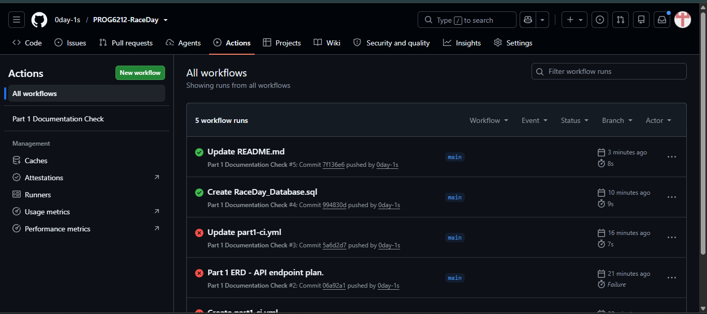

# RaceDay Event Management System

## Project Description
RaceDay is a full-stack, web-based event management system built for the South African road running, walking, and cycling community. The platform allows Event Organisers to create and manage events, categories, and participant results, while Participants can browse upcoming events, enter events, and track their personal performance history.

This repository contains the Portfolio of Evidence (PoE) for PROG6212 (Programming 2B), submitted in three parts:
- **Part 1** — System planning: ERD, API endpoint plan, SQL database script.


## User Roles

### Organiser
Can create, edit, and delete events, manage event categories, capture participant results, and view all enrolments for their events.

### Participant
Can create an account, browse events, enter an event by selecting a category, view their own enrolments, and track their personal race results.

## PART 1 — System Planning and Database
Located in `/docs`:
- `RaceDay_ERD.pdf` — Entity Relationship Diagram (6 entities: Users, Venues, Events, Categories, Enrolments, Results), showing primary keys, foreign keys, and relationship cardinality.
- `RaceDay_API_Endpoint_Plan.md` — Full API endpoint plan covering Authentication, User Profile, Events, Categories, Event Enrolments, and Results.
- `RaceDay_Database.sql` — SQL Server script creating the full schema with constraints and realistic seed data.

## Database Setup
1. Open SQL Server Management Studio (or Visual Studio's SQL Server query tool) and connect to a SQL Server instance.
2. Open `docs/RaceDay_Database.sql`.
3. Execute the entire script (F5). It will create all six tables (Users, Venues, Events, Categories, Enrolments, Results) with primary keys, foreign keys, and constraints, then seed the database with sample Organisers, Participants, Events, Categories, Enrolments, and Results.
4. Confirm the tables and seed data by expanding the database in Object Explorer or running a `SELECT * FROM dbo.Users;`.

## CI/CD
A GitHub Actions workflow (`.github/workflows/part1-ci.yml`) validates the repository structure on every push — checking that the `docs` folder exists and contains the ERD, API endpoint plan, and SQL script, and that this README is present.

**Successful green build:**

   

## Video Demonstration
 YouTube link: https://youtu.be/FdBuXrbSOjo


 # Part 2: RESTful API

## Project Description
RaceDay is a full-stack event management system for South African road running, walking, and cycling events. Event Organisers create and manage events, categories, and participant results; Participants browse events, enter them, and track their own results.

This part of the Portfolio of Evidence implements the RESTful API in ASP.NET Core, consuming the database designed in Part 1.

## User Roles

### Organiser
Can create, edit, and delete events, manage event categories, capture participant results, and view all enrolments for their events.

### Participant
Can create an account, browse events, enter an event by selecting a category, view their own enrolments, and track their personal race results.

## Technologies Used
- ASP.NET Core Web API (.NET 10)
- Entity Framework Core (Code-First) with SQL Server
- Session-based authentication with BCrypt password hashing
- Swashbuckle / Swagger for interactive API documentation
- xUnit with an isolated in-memory EF Core database for automated testing
- GitHub Actions for CI/CD

## Project Structure
```
RaceDay/
├── RaceDay.API/                  The Web API project
│   ├── Controllers                AuthController, ProfileController, EventsController,
│   │                               CategoriesController, EnrolmentsController, ResultsController
│   ├── Data                       RaceDayDbContext
│   ├── Filters                    RequireRoleAttribute (custom role-based authorization filter)
│   ├── Migrations                 EF Core Code-First migrations
│   └── Models                     AppUser, Venue, Event, Category, Enrolment, Result
├── RaceDay.Contracts/             Shared DTOs (RegisterRequest, EventDto, etc.)
├── RaceDay.API.Tests/             xUnit test project
├── .github/workflows/             GitHub Actions CI/CD workflows
└── RaceDay.slnx                   Solution file
```

## Database Setup
1. Open the project in Visual Studio 2022 (or later), targeting .NET 10.
2. Update the `DefaultConnection` string in `RaceDay.API/appsettings.json` if your SQL Server instance name differs from `localhost`.
3. Open **Tools → NuGet Package Manager → Package Manager Console**, set the default project to `RaceDay.API`, and run:
   ```
   Update-Database
   ```
   This applies the Code-First migrations and creates `RaceDayDb` with all 6 tables.

## How to Run the API
1. Set `RaceDay.API` as the startup project.
2. Press **F5** (or `dotnet run` from the `RaceDay.API` folder).
3. Navigate to `https://localhost:<port>/swagger` to view and test all endpoints interactively.

## Authentication
- Users register via `POST /api/auth/register`, selecting a role of either `Organiser` or `Participant`.
- Passwords are hashed with BCrypt before being stored — the original password is never saved.
- On login (`POST /api/auth/login`), a server-side session is created storing the user's ID and role.
- Protected endpoints use a custom `[RequireRole]` authorization filter: requests with no active session return `401 Unauthorized`; requests from a logged-in user with the wrong role return `403 Forbidden`.
- Ownership checks (e.g. an Organiser editing an Event) are enforced in addition to role checks, so one Organiser cannot modify another Organiser's data.

## API Endpoints
Implemented controllers and routes:


| Categories | `GET /api/events/{eventId}/categories`, `POST /api/events/{eventId}/categories`, `PUT /api/categories/{id}`, `DELETE /api/categories/{id}` |
| Enrolments | `POST /api/events/{eventId}/enrolments`, `GET /api/enrolments/mine`, `GET /api/events/{eventId}/enrolments`, `PUT /api/enrolments/{id}/status` |
| Results | `POST /api/enrolments/{enrolmentId}/result`, `GET /api/results/mine`, `GET /api/events/{eventId}/results` |

Route naming (e.g. `/api/profile/me`, `/api/events/mine`) follows the official Part 2 module guide's "my own resource" session-based conventions.

## Swagger
All endpoints are visible and testable via the Swagger UI at `/swagger`, grouped by controller (Auth, Profile, Events, Categories, Enrolments, Results).

## Unit Testing
`RaceDay.API.Tests` contains automated tests covering:
- Successful and failed user registration and login.
- Unauthenticated access to protected endpoints (expects `401`).
- Role enforcement — a Participant attempting an Organiser-only action (expects `403`).
- Successful Event creation by an Organiser (expects `201`).
- Successful Participant enrolment in an Event and Category.

Tests run against an isolated in-memory database (via a dedicated internal service provider, separate from the SQL Server provider used at runtime) so they never touch real data.

Run locally via **Test → Test Explorer → Run All Tests** in Visual Studio.

## CI/CD
A GitHub Actions workflow (`.github/workflows/part2-ci.yml`) runs on every push: it restores, builds, and runs the full test suite.

**Successful green build:**


## Video Demonstration
Unlisted YouTube link: `[INSERT PART 2 YOUTUBE LINK HERE]`

