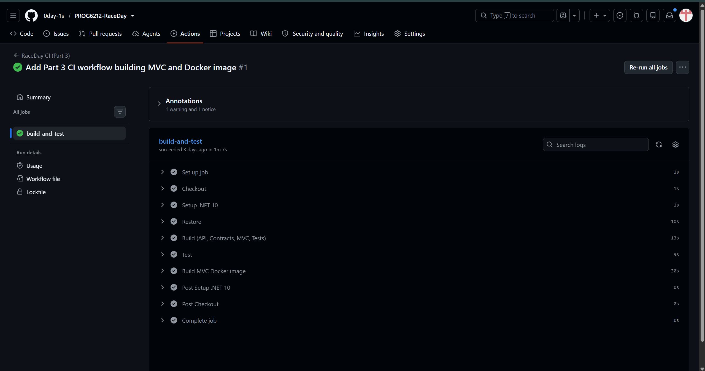

# RaceDay - Part 3: MVC Web Application, Azure Blob Storage and Docker

RaceDay is a full-stack event management system for South African road running, walking and cycling events. Event Organisers create and manage events, categories, enrolments and results. Participants browse events, enter them, and track their own results.

**Part 3** adds the ASP.NET Core MVC web application (`RaceDay.Mvc`), image uploads to Azure Blob Storage, a Docker container for the MVC app and an updated GitHub Actions workflow. The MVC app uses the RESTful API (`RaceDay.API`) that is in the same repository.

## User Roles

### Organiser
- Dashboard with event and enrolment totals.
- Create, edit and delete their own events, and upload an event banner image.
- Manage event categories.
- View enrolments for their events and confirm or cancel them.
- Capture race results (finish time and position).

### Participant
- Register, log in and edit their profile, including a profile picture.
- Browse and filter upcoming events, and open event details.
- Enter an event by choosing a category.
- View their entries (My Events) and their race results (My Results).

## Technologies Used
- ASP.NET Core Web API and ASP.NET Core MVC (.NET 10)
- Entity Framework Core (Code-First) with SQL Server
- Session-based authentication with BCrypt password hashing
- Azure Blob Storage (`Azure.Storage.Blobs`) for images
- Bootstrap 5 with a custom RaceDay theme (`wwwroot/css/site.css`)
- Swashbuckle / Swagger for API documentation
- xUnit with an isolated in-memory EF Core database
- Docker (multi-stage build) for the MVC application
- GitHub Actions for CI/CD

## Solution Structure
```
RaceDay/
├── RaceDay.API/                  Web API (the only project that talks to SQL Server and Azure)
│   ├── Controllers/               Auth, Profile, Events, Categories, Enrolments, Results,
│   │                               Venues, Uploads (banner / profile picture / image streaming)
│   ├── Data/                      RaceDayDbContext
│   ├── Filters/                   RequireRoleAttribute (role-based authorization filter)
│   ├── Services/                  BlobStorageService (Azure Blob Storage)
│   ├── Migrations/                EF Core migrations
│   └── Models/                    AppUser, Venue, Event, Category, Enrolment, Result
├── RaceDay.Contracts/             Shared DTOs used by both the API and the MVC app
├── RaceDay.Mvc/                   Part 3 MVC web application
│   ├── Controllers/               Auth, Home, Organiser, Participant, Media, Images
│   ├── Services/                  RaceDayApiClient (all API calls, session cookie forwarding)
│   ├── ViewModels/                View models for forms and pages
│   ├── Views/                     Razor views (Auth, Home, Organiser, Participant, Media, Shared)
│   ├── wwwroot/                   Bootstrap, site.css, scripts
│   └── Dockerfile                 Multi-stage Docker build for the MVC app
├── RaceDay.API.Tests/             xUnit tests (20 tests)
├── docs/Screenshots/              Evidence screenshots used in this README
├── .github/workflows/             GitHub Actions workflows (p3.yml builds the MVC project)
├── .dockerignore
└── RaceDay.slnx                   Solution file (API, Contracts, Tests and MVC)
```

## API Used by the MVC Application
`RaceDay.API` exposes the endpoints below. The database has six tables (`Users`, `Venues`, `Events`, `Categories`, `Enrolments`, `Results`). All data access and all file storage goes through this API.

| Area | Routes |
|---|---|
| Auth | `POST /api/auth/register`, `POST /api/auth/login`, `POST /api/auth/logout` |
| Profile | `GET /api/profile/me`, `PUT /api/profile/me`, `POST /api/profile/me/picture` |
| Events | `GET /api/events`, `GET /api/events/{id}`, `GET /api/events/mine`, `POST /api/events`, `PUT /api/events/{id}`, `DELETE /api/events/{id}`, `POST /api/events/{id}/banner` |
| Venues | `GET /api/venues` |
| Categories | `GET /api/events/{eventId}/categories`, `POST /api/events/{eventId}/categories`, `PUT /api/categories/{id}`, `DELETE /api/categories/{id}` |
| Enrolments | `POST /api/events/{eventId}/enrolments`, `GET /api/enrolments/mine`, `GET /api/enrolments/event/{eventId}`, `PUT /api/enrolments/{id}/status` |
| Results | `POST /api/results`, `GET /api/results/mine`, `GET /api/results/event/{eventId}` |
| Images | `GET /api/images/{blobName}` (streams images from the private container) |

Every endpoint is documented in Swagger at `/swagger`, including the possible response codes.

## MVC Web Application
`RaceDay.Mvc` is the user interface. It never connects to SQL Server or Azure directly. It calls `RaceDay.API` through a typed `RaceDayApiClient`, and file uploads travel **MVC -> API -> Azure Blob Storage**.

## Prerequisites
- Windows with Visual Studio 2022 or later (ASP.NET workload) and the .NET 10 SDK
- SQL Server (the default instance, `localhost`)
- Docker Desktop with Linux containers (WSL 2)
- An Azure subscription with a Storage Account (Azure for Students works)

## Database Setup
1. Check the `DefaultConnection` string in `RaceDay.API/appsettings.json`. The default is `Server=localhost;Database=RaceDayDb;Trusted_Connection=True;TrustServerCertificate=True;`.
2. From the solution folder, apply the migrations:
   ```
   dotnet ef database update --project RaceDay.API --startup-project RaceDay.API
   ```
   This creates `RaceDayDb` with all tables.

## Azure Blob Storage Setup
1. In the Azure portal, create a **Storage Account** (Standard, LRS).
2. Open **Access keys** and copy the connection string of `key1`.
3. Store it as a **user secret** for the API. The real connection string is never committed to GitHub:
   ```
   dotnet user-secrets set "AzureBlobStorage:ConnectionString" "<your-connection-string>" --project RaceDay.API
   dotnet user-secrets set "AzureBlobStorage:ContainerName" "raceday-images" --project RaceDay.API
   ```
   Alternatively, use environment variables `AzureBlobStorage__ConnectionString` and `AzureBlobStorage__ContainerName`.
4. The API creates the private container `raceday-images` on first upload.

How images work:
- Organisers upload an event banner (`POST /api/events/{id}/banner`) and users upload a profile picture (`POST /api/profile/me/picture`).
- The API checks the role and event ownership, accepts only JPG, PNG, WEBP or GIF up to 5 MB, uploads the file to Blob Storage and saves the blob URL in the database.
- The container stays **private**. Images are displayed through `GET /api/images/{blobName}`, which MVC exposes as `/Images/Show?url=...`. Nothing in the storage account is made public.

## How to Run RaceDay.API
```
dotnet run --project RaceDay.API --launch-profile http
```
The API listens on `http://localhost:5010`. Swagger is at `http://localhost:5010/swagger`.

To let a Docker container reach the API, run it on all network interfaces instead:
```
dotnet run --project RaceDay.API --launch-profile http --urls http://0.0.0.0:5010
```
If Windows Firewall asks, allow access on private networks.

## How to Run RaceDay.Mvc Locally
1. Make sure the API is running (above).
2. `RaceDay.Mvc/appsettings.json` points to the API: `"ApiSettings": { "BaseUrl": "http://localhost:5010/" }`.
3. In Visual Studio, set `RaceDay.Mvc` as the startup project and press **F5**. The site opens at `https://localhost:7048`.

## Docker Setup
The MVC application runs in a container. The API and database stay on the host machine, so the API must be running and reachable at the base URL given to the container.

### Build Image
From the solution folder:
```
docker build -f RaceDay.Mvc/Dockerfile -t raceday-mvc:part3 .
```
The Dockerfile has a **build** stage (.NET 10 SDK image: restore and publish) and a **final** stage (.NET 10 ASP.NET runtime image) that copies the published output and listens on port 8080.

### Run Container
1. Start the API on all interfaces (see above, `--urls http://0.0.0.0:5010`).
2. Run the verified command:
   ```
   docker run -d --name raceday-mvc -p 8080:8080 -e ApiSettings__BaseUrl=http://host.docker.internal:5010/ raceday-mvc:part3
   ```
3. Open `http://localhost:8080`.

`host.docker.internal` is how a container on Docker Desktop reaches the host machine. If the API is not running, or is not reachable at `ApiSettings__BaseUrl`, the container still starts but every data page will fail.

Useful commands:
```
docker ps
docker logs raceday-mvc
docker stop raceday-mvc
docker rm raceday-mvc
```

## Authentication and Session Flow
1. The user registers or logs in on the MVC site. MVC posts the credentials to `POST /api/auth/login`.
2. The API verifies the BCrypt password hash and creates a server-side session, returning a session cookie.
3. MVC reads that cookie from the response and keeps it in its **own** server-side session, together with `UserId`, `Role` and `DisplayName`. The raw API cookie is never sent to the browser.
4. For every later request, `RaceDayApiClient` forwards the stored cookie to the API as a `Cookie` header, so the API still applies its `[RequireRole]` and ownership rules.
5. The navigation bar changes with the role, and each MVC controller checks the role before it does any work. A logged-out user is sent to the login page, and the wrong role is sent to an Access Denied page.
6. If the API answers `401`, MVC clears the session and sends the user back to login with a message. Other API errors are turned into friendly messages.

## Organiser Features
- **Dashboard:** number of events, total enrolments, next event, enrolments per event.
- **Events:** create, edit, delete, with venue selection and a banner image.
- **Categories:** add, edit and delete categories for each event.
- **Enrolments:** filter by event, with colour-coded statuses (Pending amber, Confirmed green, Cancelled grey), and confirm or cancel entries.
- **Results:** capture finish time and position for confirmed enrolments.

## Participant Features
- **Events:** browse upcoming events, filter by type and search by name, description or venue.
- **Event details:** banner, venue, categories, and entering an event.
- **My Events:** every entry with its status badge.
- **My Results:** event, date, category, finish time and position.
- **Profile:** edit name and phone number, and upload a profile picture.

## Unit Testing
`RaceDay.API.Tests` contains 20 automated tests that run against an isolated in-memory database:
- Registration and login (success and failure).
- Unauthenticated access to protected endpoints returns `401`.
- Role enforcement returns `403` (for example a Participant creating an event or uploading a banner).
- Event creation by an Organiser, and Participant enrolment.
- Upload endpoints: unauthenticated, wrong role, missing event, someone else's event, and a non-image file.
- The image endpoint refuses paths outside the allowed folders.
- Venues list, and participant, event and category names in the enrolment list.

The tests use a fake Blob connection string and never call Azure.

Run them with `dotnet test RaceDay.slnx`.


## CI/CD
`.github/workflows/p3.yml` ("RaceDay CI (Part 3)") runs on every push and pull request to `main`. It restores and builds the **whole solution (API, Contracts, MVC and Tests)**, runs all the tests and builds the MVC Docker image.

## GitHub Actions Screenshot


## Docker Evidence
| Evidence | Screenshot |
|---|---|
| Docker Desktop with the engine running |  |
| `docker --version` |  |
| Successful `docker build` |  |
| `docker images` and `docker ps` |  |
| RaceDay running on `localhost:8080` |  |
| `docker logs` showing API calls succeeding |  |

## Deviations from the Student Guide
| Guide reference | What I did | Why |
|---|---|---|
| API on port 5000 | API on port 5010 | Port chosen for my launch profile, so the Docker command uses `host.docker.internal:5010` |
| `RaceDay.sln` | `RaceDay.slnx` | The .NET 10 SDK creates the new solution format, and CI builds it |
| .NET 8 Docker images | .NET 10 images | The solution targets .NET 10 |
| Direct blob URL in `` | Images streamed through the API (`/api/images/...`) | The container stays private, so it is not weakened to make a demo easier |
| Existing DTOs | Added `VenueDto` and the name fields on `EnrolmentDto` and `ResultDto` | The MVC pages need to show names without querying the database |

## Image Credits
Event banner photos and the profile picture are from `[ADD SOURCE, e.g. Unsplash / Pexels / DiceBear]`.

## Video Presentation
Unlisted YouTube link: https://youtu.be/AXHyNQV_3Hw
